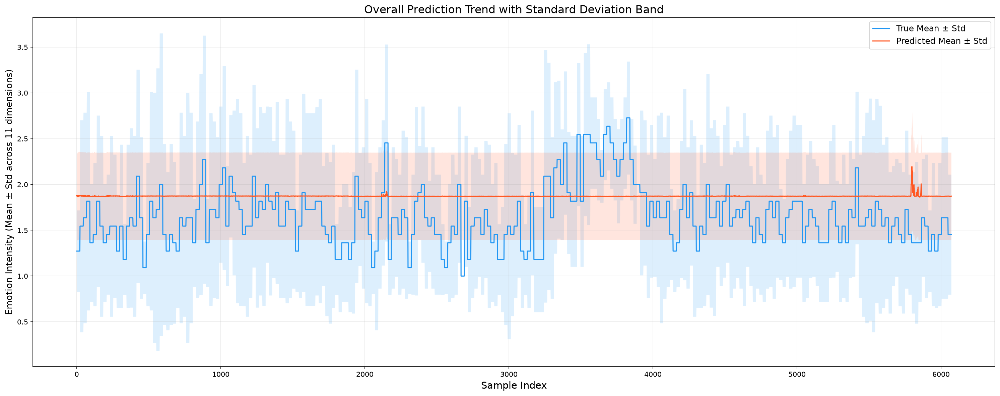
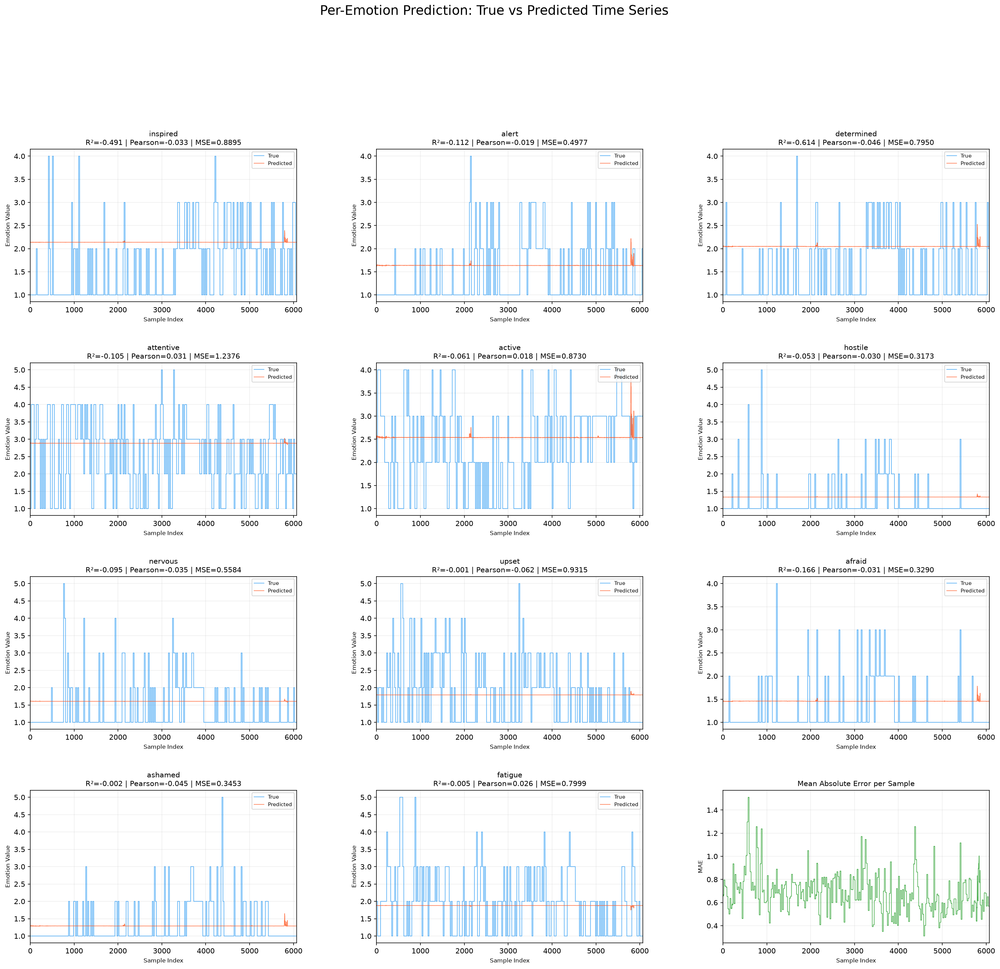
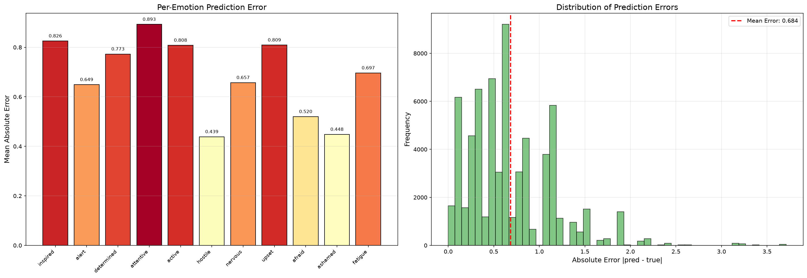
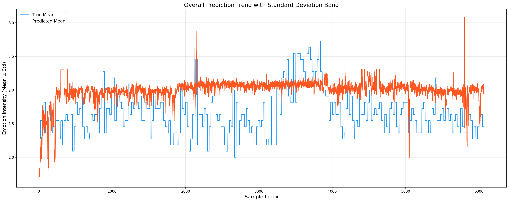
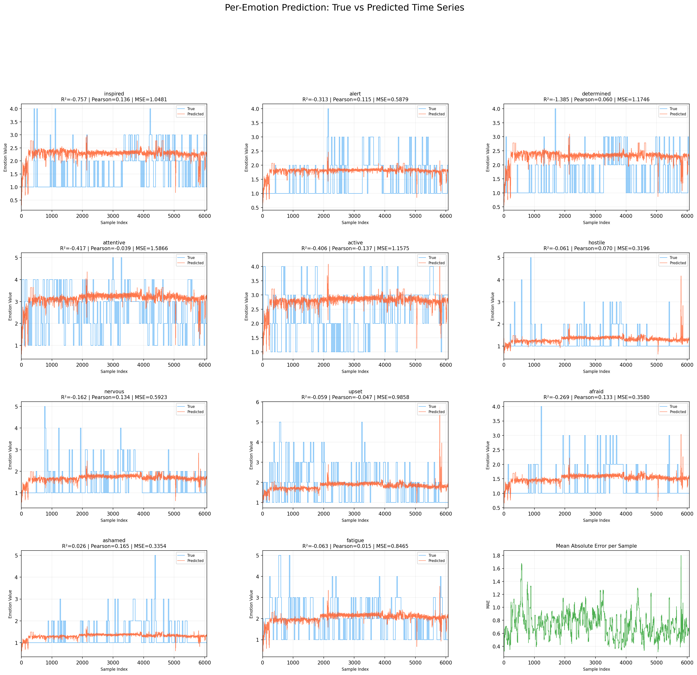
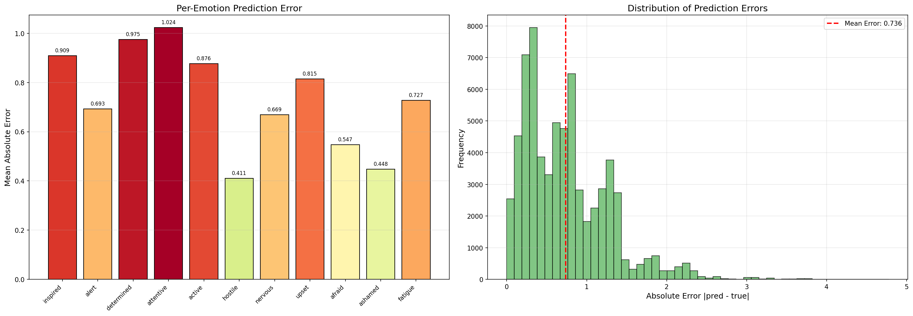

# CADT 模型实验报告：消融实验与 t_size 调整

> 数据集：DailyEEG（情绪回归任务，11 维连续标签）
> 数据来源：`result_day_td/` 与 `result_day_td_ablation/`
> 报告生成日期：2026-08-07

---

## 一、实验概述

本轮实验对比 CADT 模型在 DailyEEG 情绪回归任务上的两种设置：

1. **消融实验**：去掉对抗判别器（discriminator）与域分类器（domain_classifier），只保留回归损失 + 对比损失
2. **t_size 调整**：编码器嵌入维度 `t_size` 从 8 调整到 32 / 128

所有实验使用相同超参，仅展示**测试集（Test Set）**指标。多 seed 结果以 **mean ± sd** 形式呈现。

---

## 二、实验设置

### 2.1 三种 split_mode 的任务差异

| split_mode | domain 定义 | 源域数 | 划分原则 | 难度 |
|------------|------------|--------|---------|------|
| **cross_subject** | 被试 ID | 9 / 3 / 3 | 被试完全互斥 | ★★★ |
| **cross_day** | (被试, 天) | 90 / 30 / 31 | (被试,天) 组合互斥 | ★★ |
| **within_subject_day** | (被试, 天) | 151 个 domain 同时在训练/测试（按时间比例切分样本） | 同被试同一天按时序切分 | ★ |

### 2.2 被研究变量

- `ablation`：`none`（完整模型）/ `variant`（仅保留回归损失 + 对比损失）
- `t_size`：8（默认）/ 32 / 128

---

## 三、cross_subject（最难：未见被试泛化）

### 3.1 完整模型（ablation=none）

| t_size | N | Test MSE | Test R² | Test Avg R² | Test Pearson |
|--------|---|----------|---------|-------------|-------------|
| **8** | **5** | **0.7118 ± 0.0250** | **0.0926 ± 0.0318** | **-0.1979 ± 0.0424** | -0.0193 ± 0.0260 |
| 32 | 2 | 0.7117 ± 0.0327 | 0.0928 ± 0.0417 | -0.1998 ± 0.0632 | -0.0111 ± 0.0134 |
| 128 | 1 | 0.7245 | 0.0765 | -0.2216 | 0.0166 |

**各 seed 明细 (t_size=8)：**
| 运行 | MSE | R² | Avg R² |
|------|-----|-----|--------|
| 20260730_122424 | 0.6963 | 0.1124 | -0.1707 |
| 20260731_003226 | 0.6958 | 0.1130 | -0.1715 |
| 20260731_045554 | 0.6899 | 0.1206 | -0.1610 |
| 20260731_060827 | 0.7453 | 0.0500 | -0.2553 |
| 20260731_094824 | 0.7318 | 0.0672 | -0.2311 |

### 3.2 消融模型（ablation=variant）

| t_size | N | Test MSE | Test R² | Test Avg R² | Test Pearson |
|--------|---|----------|---------|-------------|-------------|
| **8** | **5** | **0.8170 ± 0.0944** | **-0.0415 ± 0.1204** | **-0.3618 ± 0.1597** | 0.0252 ± 0.0227 |
| 128 | 1 | 0.7697 | 0.0188 | -0.2950 | 0.0348 |

### 3.3 消融 vs 完整（t_size=8 横向对比）

| 配置 | N | Test MSE | Test R² | Test Avg R² | Test Pearson |
|------|---|----------|---------|-------------|-------------|
| **完整** | 5 | **0.7118 ± 0.0250** | **0.0926 ± 0.0318** | **-0.1979 ± 0.0424** | -0.0193 ± 0.0260 |
| **消融** | 5 | 0.8170 ± 0.0944 | -0.0415 ± 0.1204 | -0.3618 ± 0.1597 | 0.0252 ± 0.0227 |
| **Δ (消融−完整)** | — | **+0.1052** | **−0.1341** | **−0.1639** | **+0.0445** |

### 3.4 时序可视化示例

以下以 cross_subject 为例，对比展示完整模型与消融模型的时序预测效果。

#### 完整模型（t_size=32, run=0805_093745, R²=0.122）

**总体趋势（Mean ± Std 阴影带）：**

**11 种情绪分维度时序：**

**误差分析：**

#### 消融模型（t_size=8, run=0804_054104, R²=−0.042）

**总体趋势（Mean ± Std 阴影带）：**

**11 种情绪分维度时序：**

**误差分析：**

**cross_subject 结论：**
- 域对齐模块不可或缺：消融后 R² 从 0.09 降到 −0.04，Avg R² 从 −0.20 降到 −0.36
- t_size=32 与 t_size=8 均值几乎相同（R² 0.093 vs 0.093），但 t=32 仅 2 次运行
- t_size=128 略差于 8 和 32

---

## 四、cross_day（中等：跨天泛化）

### 4.1 完整模型 vs 消融模型（t_size=8）

| 配置 | N | Test MSE | Test R² | Test Avg R² | Test Pearson |
|------|---|----------|---------|-------------|-------------|
| **完整** | **5** | **0.8413 ± 0.0016** | **0.1779 ± 0.0016** | **-0.0135 ± 0.0021** | 0.0848 ± 0.0868 |
| **消融** | **5** | 0.8852 ± 0.0363 | 0.1350 ± 0.0355 | -0.0577 ± 0.0400 | **0.1577 ± 0.0180** |
| **Δ (消融−完整)** | — | **+0.0439** | **−0.0429** | **−0.0442** | **+0.0729** |

**各 seed 明细：**
| 配置 | 运行 | MSE | R² | Avg R² |
|------|------|-----|-----|--------|
| 完整 | 0803_091510 | 0.8421 | 0.1771 | -0.0147 |
| 完整 | 0803_091612 | 0.8403 | 0.1789 | -0.0125 |
| 完整 | 0803_150055 | 0.8406 | 0.1786 | -0.0124 |
| 完整 | 0803_150135 | 0.8400 | 0.1792 | -0.0114 |
| 完整 | 0803_234956 | 0.8438 | 0.1755 | -0.0166 |
| 消融 | 0804_110003 | 0.8441 | 0.1752 | -0.0095 |
| 消融 | 0804_110013 | 0.8892 | 0.1311 | -0.0512 |
| 消融 | 0804_151433 | 0.8750 | 0.1450 | -0.0585 |
| 消融 | 0804_151450 | 0.9430 | 0.0785 | -0.1205 |
| 消融 | 0805_005846 | 0.8747 | 0.1453 | -0.0489 |

**cross_day 结论：**
- 完整模型非常稳定：R² sd 仅 0.0016
- 消融后 R² 下降约 0.04，Avg R² 从 −0.01 降到 −0.06
- **反直觉现象**：消融模型的 Pearson 反而更高（0.158 vs 0.085）且更稳定（sd 0.018 vs 0.087）
- 消融方差明显大于完整模型

---

## 五、within_subject_day（最易：同被试同一天切时间窗）

### 5.1 完整模型 vs 消融模型（t_size=8）

| 配置 | N | Test MSE | Test R² | Test Avg R² | Test Pearson |
|------|---|----------|---------|-------------|-------------|
| **完整** | 1 | 0.8785 | 0.1925 | -0.0188 | 0.0989 |
| **消融** | **2** | **0.8618 ± 0.0067** | **0.2078 ± 0.0061** | **-0.0090 ± 0.0066** | **0.3440 ± 0.0090** |
| **Δ (消融−完整)** | — | **−0.0167** | **+0.0153** | **+0.0098** | **+0.2451** |

**各 seed 明细（消融）：**
| 运行 | MSE | R² | Avg R² | Pearson |
|------|-----|-----|--------|---------|
| 0805_020556 | 0.8571 | 0.2121 | -0.0043 | 0.3503 |
| 0805_020602 | 0.8665 | 0.2035 | -0.0137 | 0.3376 |

**within_subject_day 结论：**
- **消融模型反而优于完整模型**：R² +0.015，Avg R² 从 −0.019 改善到 −0.009，Pearson +0.245
- 消融模型表现非常稳定（两次运行 sd 极小）
- 但完整模型仅 1 次运行，结论需更多完整模型实验验证

---

## 六、跨 split_mode 汇总对比

### 6.1 消融效果（Δ = 消融 − 完整，t_size=8）

| split_mode | N (完整/消融) | Δ Test MSE | Δ Test R² | Δ Test Avg R² | Δ Test Pearson |
|------------|-------------|-----------|----------|---------------|---------------|
| cross_subject | 5 / 5 | **+0.1052** | **−0.1341** | **−0.1639** | +0.0445 |
| cross_day | 5 / 5 | +0.0439 | −0.0429 | −0.0442 | **+0.0729** |
| within_subject_day | 1 / 2 | **−0.0167** | **+0.0153** | **+0.0098** | **+0.2451** |

### 6.2 核心结论

1. **域对齐模块的价值与任务难度正相关**：
   - `cross_subject`（最难）：域对齐不可或缺，去后 R² 从 0.09 降到 −0.04，Avg R² 从 −0.20 降到 −0.36
   - `cross_day`（中等）：域对齐有效但作用减弱，R² 降 0.04
   - `within_subject_day`（最易）：**消融反而更好**，R² / Avg R² / Pearson 全面提升

2. **t_size=32 在 cross_subject 上不显著优于 t=8**：
   - 完整模型下 t=8 (0.093 ± 0.032) 与 t=32 (0.093 ± 0.042) 差异极小
   - t=128 (0.077) 反而更差

3. **稳定性对比**：
   - `cross_day` 完整模型最稳定（R² sd 仅 0.0016）
   - `cross_subject` 消融模型最不稳定（R² sd 0.120）

### 6.3 后续建议

- **补实验**：
  - `within_subject_day` 完整模型需补到 5 次以上（当前仅 1 次）
  - `cross_subject` 的 `t_size=32` 需补到 5 次以上（当前仅 2 次）
  - `cross_day` / `within_subject_day` 需补 `t_size=32/128` 的完整模型实验
- **消融拆分**：将 `variant` 拆为「仅去 discriminator」和「仅去 domain_classifier」
- **生成时序图**：为 cross_day / within_subject_day 实验运行 `plot_timeseries.py` 生成可视化

---

## 附录：实验目录索引

### cross_subject

| 配置 | 目录 |
|------|------|
| none, t=8 | `result_day_td/20260730_122424_emotion_cross_subject` |
| none, t=8 | `result_day_td/20260731_003226_emotion_cross_subject` |
| none, t=8 | `result_day_td/20260731_045554_emotion_cross_subject` |
| none, t=8 | `result_day_td/20260731_060827_emotion_cross_subject` |
| none, t=8 | `result_day_td/20260731_094824_emotion_cross_subject` |
| none, t=32 | `result_day_td/tsize32/20260805_093745_emotion_cross_subject` |
| none, t=32 | `result_day_td/tsize32/20260805_100538_emotion_cross_subject` |
| none, t=128 | `result_day_td/tsize128/20260805_134932_emotion_cross_subject` |
| variant, t=8 | `result_day_td_ablation/20260804_054104_emotion_cross_subject` |
| variant, t=8 | `result_day_td_ablation/20260804_074315_emotion_cross_subject` |
| variant, t=8 | `result_day_td_ablation/20260804_083954_emotion_cross_subject` |
| variant, t=8 | `result_day_td_ablation/20260804_084337_emotion_cross_subject` |
| variant, t=8 | `result_day_td_ablation/20260804_095246_emotion_cross_subject` |
| variant, t=128 | `result_day_td_ablation/tsize128/20260806_074132_emotion_cross_subject` |

### cross_day

| 配置 | 目录 |
|------|------|
| none, t=8 | `result_day_td/20260803_091510_emotion_cross_day` |
| none, t=8 | `result_day_td/20260803_091612_emotion_cross_day` |
| none, t=8 | `result_day_td/20260803_150055_emotion_cross_day` |
| none, t=8 | `result_day_td/20260803_150135_emotion_cross_day` |
| none, t=8 | `result_day_td/20260803_234956_emotion_cross_day` |
| variant, t=8 | `result_day_td_ablation/20260804_110003_emotion_cross_day` |
| variant, t=8 | `result_day_td_ablation/20260804_110013_emotion_cross_day` |
| variant, t=8 | `result_day_td_ablation/20260804_151433_emotion_cross_day` |
| variant, t=8 | `result_day_td_ablation/20260804_151450_emotion_cross_day` |
| variant, t=8 | `result_day_td_ablation/20260805_005846_emotion_cross_day` |

### within_subject_day

| 配置 | 目录 |
|------|------|
| none, t=8 | `result_day_td/20260803_235048_emotion_within_subject_day` |
| variant, t=8 | `result_day_td_ablation/20260805_020556_emotion_within_subject_day` |
| variant, t=8 | `result_day_td_ablation/20260805_020602_emotion_within_subject_day` |
