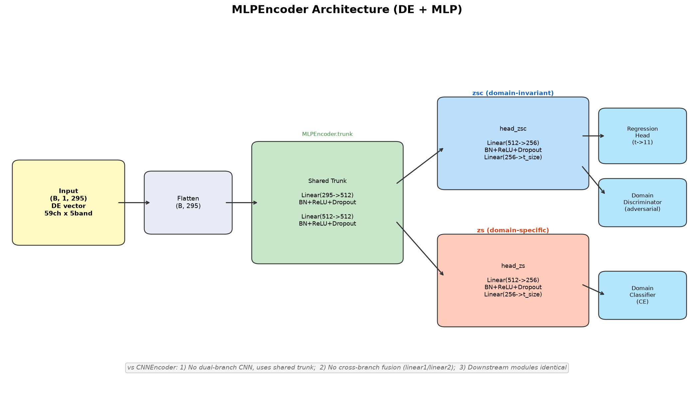
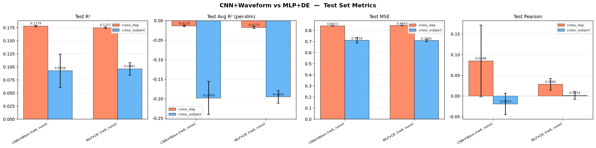
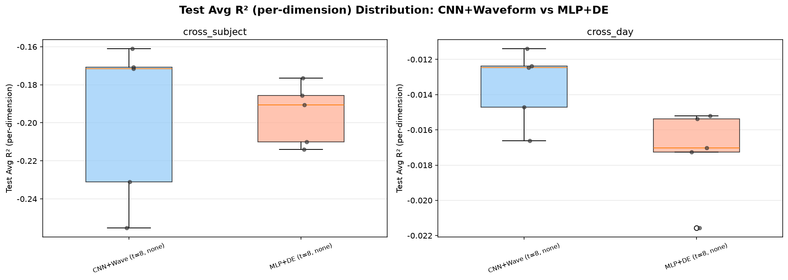

# 实验报告: MLP+DE vs CNN+Waveform

## 1. 概述

本报告对比了 CADT 域适应框架在 DailyEEG 情绪回归任务上的两种编码器配置:

| | CNN+Waveform | MLP+DE |
|---|---|---|
| **输入** | 原始 EEG 波形 (B, 2000, 59) | DE 特征向量 (B, 1, 295) |
| **编码器** | CNNEncoder (双分支 CNN + 跨分支融合) | MLPEncoder (共享 trunk + 双 head) |
| **x_dim / seq_len** | 59 / 2000 | 295 / 1 |
| **数据目录** | `/vePFS-0x0d/DailyEEG/processed_cadt_addtime_new/` | `/vePFS-0x0d/home/zjm/de_data/` |
| **标准化** | 按天 z-score | 逐样本 (DE 提取时已按天归一化) |
| **t_size** | 8 | 8 |
| **消融模式** | none (完整模型) | none (完整模型) |
| **下游模块** | RegressionHead + MultiDomainDiscriminator + MultiDomainClassifier (完全相同) | 完全相同 |

两种配置使用相同的 emotion split 数据划分 (`cross_subject` 和 `cross_day`)，相同的损失权重 (sphere=10.0, disc=1.0, dom=1.0)，以及相同的训练计划 (351 epochs, batch=256)。每组配置各运行 5 个随机种子。

---

## 2. MLPEncoder 结构

**与 CNNEncoder 的主要区别:**

1. **无双分支 CNN**: 使用共享的 2 层 MLP trunk (295 -> 512 -> 512) 替代并行的局部/全局 CNN 分支
2. **无跨分支融合**: CNNEncoder 中的 `linear1`/`linear2` 跨分支连接被移除；`zsc` 和 `zs` 由同一个 trunk 通过两个独立的线性 head 产生
3. **下游模块完全相同**: RegressionHead、MultiDomainDiscriminator 和 MultiDomainClassifier 均未改变，仅替换了特征提取器

---

## 3. 定量结果

### 3.1 汇总表 (测试集, mean ± sd, 每组 5 次运行)

| 划分模式 | 编码器 | N | Test MSE | Test R² | Test Avg R² | Test Pearson |
|---|---|---|---|---|---|---|
| cross_day | CNN+Wave (t=8) | 5 | 0.8413 ± 0.0016 | 0.1779 ± 0.0016 | -0.0136 ± 0.0022 | 0.0848 ± 0.0868 |
| cross_day | MLP+DE (t=8) | 5 | 0.8442 ± 0.0017 | 0.1751 ± 0.0017 | -0.0173 ± 0.0025 | 0.0282 ± 0.0143 |
| cross_subject | CNN+Wave (t=8) | 5 | 0.7118 ± 0.0250 | 0.0926 ± 0.0318 | -0.1979 ± 0.0363 | -0.0193 ± 0.0260 |
| cross_subject | MLP+DE (t=8) | 5 | 0.7091 ± 0.0091 | 0.0961 ± 0.0117 | -0.1953 ± 0.0155 | 0.0014 ± 0.0090 |

### 3.2 柱状图对比

### 3.3 箱线图: Test Avg R² 分布

### 3.4 关键发现

1. **cross_day**: CNN 和 MLP 在 Test R² (0.1779 vs 0.1751) 和 Test MSE (0.8413 vs 0.8442) 上表现几乎一致。但 CNN 的 Test Pearson 明显更高 (0.0848 vs 0.0282)，表明在 R² 相近的情况下，CNN 能更好地保留预测值与真实值的相关性。

2. **cross_subject**: MLP 在 Test R² 上略优于 CNN (0.0961 vs 0.0926)，且方差显著更低 (0.0117 vs 0.0318)。MLP 的 Pearson 接近零 (0.0014)，而 CNN 略偏负 (-0.0193)。两种编码器在这个更难的划分上表现都不理想，Test Avg R² 约为 -0.19 ~ -0.20。

3. **稳定性**: MLP+DE 在 cross_subject 上的 R² 标准差仅为 0.0117，是 CNN (0.0318) 的三分之一。这可能是因为 DE 特征是预计算且按天归一化的，减少了输入端的不确定性。

4. **逐维度 R²**: 两种编码器在所有设置下 Test Avg R² 均为负值，说明对单个情绪维度的预测还不如直接输出均值。整体 R² 为正是因为跨样本方差的存在，而非逐情绪的判别能力。

---

## 4. 时序图可视化示例

### 4.1 MLP+DE 在 cross_day 上的表现 (运行 20260811_072137, Test R²=0.1763)

**整体趋势 (均值 ± 标准差):**

**分情绪时序图:**

**本次运行的逐情绪测试指标:**

| 情绪 | MSE | R² | Pearson |
|---|---|---|---|
| inspired | 0.8144 | -0.0138 | -0.0876 |
| alert | 0.5828 | 0.0010 | 0.1392 |
| determined | 1.0338 | -0.0106 | 0.0305 |
| attentive | 1.3425 | -0.0061 | -0.0219 |
| active | 1.0622 | -0.0010 | -0.0034 |
| hostile | 0.5111 | -0.0018 | 0.1183 |
| nervous | 0.8076 | -0.0218 | 0.0591 |
| upset | 1.0259 | -0.0135 | 0.1065 |
| afraid | 0.7202 | -0.0316 | 0.0611 |
| ashamed | 0.4224 | -0.0146 | 0.0122 |
| fatigue | 0.9495 | -0.0539 | 0.0321 |

### 4.2 MLP+DE 在 cross_subject 上的表现 (运行 20260811_085550, Test R²=0.0816)

**整体趋势 (均值 ± 标准差):**

**分情绪时序图:**

**本次运行的逐情绪测试指标:**

| 情绪 | MSE | R² | Pearson |
|---|---|---|---|
| inspired | 1.0001 | -0.6770 | -0.0597 |
| alert | 0.5433 | -0.2138 | 0.0276 |
| determined | 0.8248 | -0.6751 | 0.0121 |
| attentive | 1.2576 | -0.1234 | 0.0118 |
| active | 0.9430 | -0.1457 | -0.0744 |
| hostile | 0.3301 | -0.0957 | -0.0089 |
| nervous | 0.5940 | -0.1652 | 0.0352 |
| upset | 0.9323 | -0.0015 | 0.0387 |
| afraid | 0.3509 | -0.2437 | 0.0142 |
| ashamed | 0.3452 | -0.0019 | 0.0301 |
| fatigue | 0.8045 | -0.0107 | -0.0274 |

