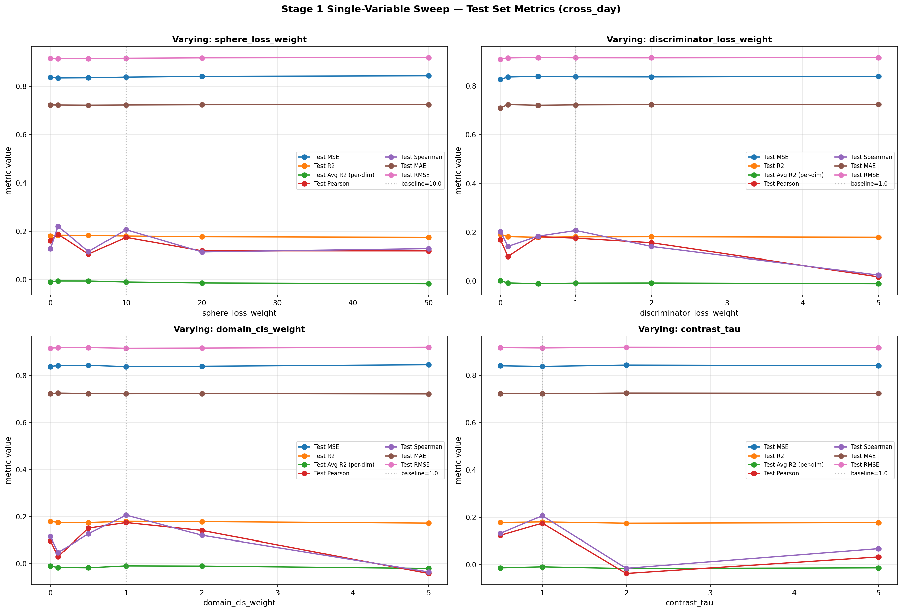
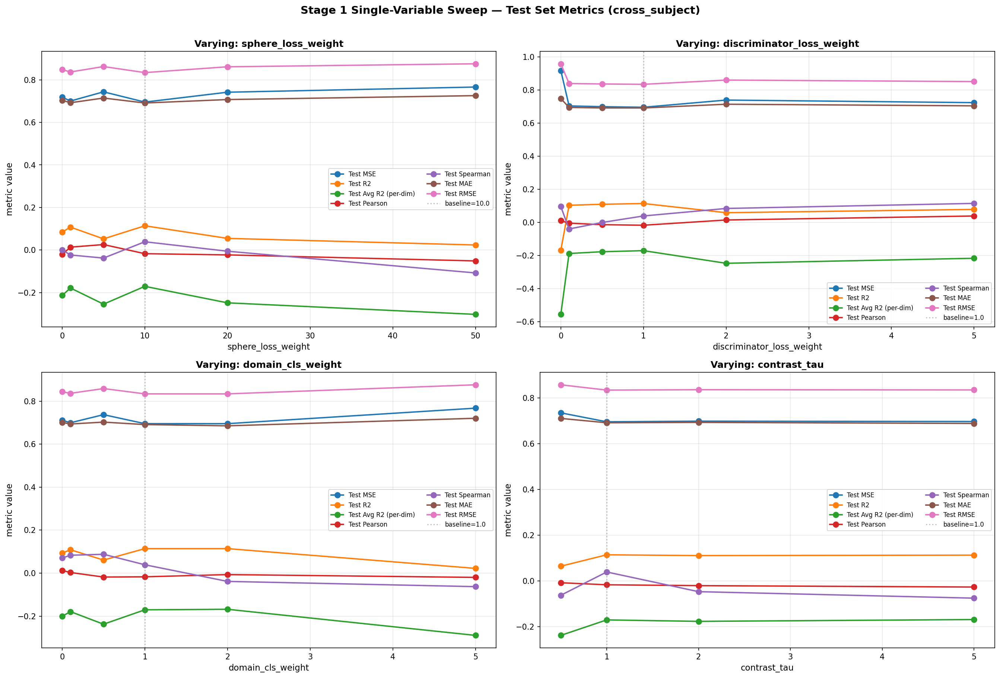

# Stage 1 单变量扫描结果总结

## 1. Loss 总公式

CADT 完整模型（`ablation=none`）训练时，总 loss 由回归 loss 和若干域适应 loss 加权求和：

$$
\mathcal{L}_{\text{total}}
= \underbrace{\mathcal{L}_{\text{reg}}}_{\text{回归}}
+ \lambda_{\text{sp}} \cdot \underbrace{\mathcal{L}_{\text{contrast}}}_{\text{对比}}
+ \lambda_{\text{disc}} \cdot \underbrace{\mathcal{L}_{\text{conf}}}_{\text{域混淆}}
+ \lambda_{\text{dom}} \cdot \underbrace{(\mathcal{L}_{\text{dom}} + \mathcal{L}_{\text{dom}}^{\text{aug}})}_{\text{域分类}}
$$

其中 $\mathcal{L}_{\text{dom}}^{\text{aug}}$ 来自数据增强分支（`with_argumentation=True` 时对增强特征再做一次域分类，见 [CADT.py:89-94](file:///root/zjm/cadt/model/CADT.py#L89-L94)）。

| 系数 | 命令行参数 | 默认值 | 作用 |
|------|-----------|--------|------|
| $\lambda_{\text{sp}}$ | `--sphere_loss_weight` | 10.0 | 对比 loss 权重 |
| $\lambda_{\text{disc}}$ | `--discriminator_loss_weight` | 1.0 | 域混淆 loss 权重 |
| $\lambda_{\text{dom}}$ | `--domain_cls_weight` | 1.0 | 域分类 loss 权重 |
| $\tau$ | `--contrast_tau` | 1.0 | 对比 loss 温度 |

> 注：`disc_loss`（判别器自身更新阶段的 CE loss）单独反向传播，不计入 `total_loss`。Stage 1 搜索的 4 个超参数即上表中的 $\lambda_{\text{sp}}, \lambda_{\text{disc}}, \lambda_{\text{dom}}, \tau$。

## 2. 各分 Loss 公式

### 2.1 回归 Loss $\mathcal{L}_{\text{reg}}$

采用 SmoothL1Loss（Huber Loss），对回归标签 $y$ 和预测 $\hat{y}$ 逐维计算：

$$
\mathcal{L}_{\text{reg}} = \frac{1}{N \cdot D} \sum_{i=1}^{N} \sum_{d=1}^{D} \text{SmoothL1}(y_{i,d},\, \hat{y}_{i,d})
$$

$$
\text{SmoothL1}(y, \hat{y}) = \begin{cases} 0.5(y - \hat{y})^2 & |y - \hat{y}| < 1 \\ |y - \hat{y}| - 0.5 & \text{otherwise} \end{cases}
$$

> 代码：[CADT.py:69](file:///root/zjm/cadt/model/CADT.py#L69) `self.reg_loss_fn(self.regressor(zsc), y_src)`

---

### 2.2 对比 Loss $\mathcal{L}_{\text{contrast}}$（RegressionAwareContrastLoss）

回归感知对比 loss，用标签距离调制样本对的特征拉近强度：标签相近的样本对权重大（拉近特征），标签差异大的样本对权重趋于 0（不拉近）。特征先 L2 归一化，距离为欧氏距离平方。

特征归一化与距离：

$$
\hat{z}_i = \frac{z_i}{\|z_i\|_2}, \qquad d^f_{ij} = \|\hat{z}_i - \hat{z}_j\|_2^2, \qquad d^y_{ij} = \|y_i - y_j\|_2
$$

权重（高斯核，温度 $\tau$）：

$$
w_{ij} = \exp\!\left(-\frac{(d^y_{ij})^2}{2\tau^2}\right)
$$

Loss（掩码 $M_{ij} = 1 - \mathbb{1}[i{=}j]$ 去掉对角线自配对）：

$$
\mathcal{L}_{\text{contrast}} = \frac{\sum_{i \neq j} w_{ij} \cdot d^f_{ij}}{\sum_{i \neq j} 1}
$$

其中 $z = z_{sc}$ 是编码器域不变分支特征，$y$ 是连续回归标签（11 维），$\tau$ 即命令行 `--contrast_tau`。

> 代码：[losses.py:26-39](file:///root/zjm/cadt/model/losses.py#L26-L39)，在 [CADT.py:72](file:///root/zjm/cadt/model/CADT.py#L72) 调用 `self.contrast_loss_fn(zsc, y_src)`（变量名 `sphere_loss`，实际是对比 loss）

---

### 2.3 域混淆 Loss $\mathcal{L}_{\text{conf}}$（Domain Confusion）

推动判别器对域不变特征 $z_{sc}$ 的输出趋向均匀分布（M 个源域），使编码器学到的特征域无关。用 KL 散度衡量：

$$
\mathcal{L}_{\text{conf}} = D_{\text{KL}}\!\left(\,\text{Uniform}\left(\tfrac{1}{M}\right) \;\Big\|\; \text{softmax}\big(\text{disc}(z_{sc})\big)\right) = \frac{1}{N} \sum_{i=1}^{N} \sum_{m=1}^{M} \frac{1}{M} \log \frac{1/M}{\text{softmax}_m(z_{sc}^{(i)})}
$$

> 代码：[CADT.py:103-106](file:///root/zjm/cadt/model/CADT.py#L103-L106) `F.kl_div(log_probs, uniform_target, reduction='batchmean')`

---

### 2.4 域分类 Loss $\mathcal{L}_{\text{dom}}$（Domain Classification）

域分类器对域特定特征 $z_s$ 做 M 路交叉熵分类，识别样本来自哪个源域。数据增强分支额外提供 $\mathcal{L}_{\text{dom}}^{\text{aug}}$：

$$
\mathcal{L}_{\text{dom}} = -\frac{1}{N} \sum_{i=1}^{N} \log \text{softmax}_{d_i}\big(\text{dom\_cls}(z_s^{(i)})\big)
$$

$$
\mathcal{L}_{\text{dom}}^{\text{aug}} = -\frac{1}{N} \sum_{i=1}^{N} \log \text{softmax}_{d_i}\big(\text{dom\_cls}(z_{s,\text{aug}}^{(i)})\big)
$$

> 代码：[CADT.py:86-94](file:///root/zjm/cadt/model/CADT.py#L86-L94) `self.ce_loss(dom_logits, dom_ids)`

---

### 2.5 判别器 Loss $\mathcal{L}_{\text{disc}}$（独立优化，不计入 total_loss）

判别器自身更新阶段，对 detach 后的 $z_{sc}$ 做源域 CE 分类。与 $\mathcal{L}_{\text{dom}}$ 公式相同，但梯度只更新判别器：

$$
\mathcal{L}_{\text{disc}} = -\frac{1}{N} \sum_{i=1}^{N} \log \text{softmax}_{d_i}\big(\text{disc}(z_{sc}^{(i)} \cdot \text{stop\_grad})\big)
$$

> 代码：[CADT.py:135-136](file:///root/zjm/cadt/model/CADT.py#L135-L136)

---

## 3. Stage 1 搜索空间

每次只变一个权重，其余 3 个固定为默认值（baseline = sphere:10, disc:1, dom:1, tau=1）。

> 括号中标注了该参数在上面总公式中对应的 Loss 名称和系数符号。
> 注意：`discriminator_loss_weight` 实际乘的是 **域混淆 Loss** $\mathcal{L}_{\text{conf}}$（训练编码器"骗过"判别器），**不是**第 2.5 节中独立更新的判别器自身 Loss。

| Sweep | 变化的权重（对应 Loss / 系数） | 候选值 | 固定值 |
|-------|------------------------------|--------|--------|
| sphere | `sphere_loss_weight`（$\mathcal{L}_{\text{contrast}}$ / $\lambda_{\text{sp}}$） | 0, 1, 5, 10, 20, 50 | disc=1, dom=1, tau=1 |
| disc | `discriminator_loss_weight`（$\mathcal{L}_{\text{conf}}$ / $\lambda_{\text{disc}}$） | 0, 0.1, 0.5, 1, 2, 5 | sphere=10, dom=1, tau=1 |
| dom | `domain_cls_weight`（$\mathcal{L}_{\text{dom}}$ / $\lambda_{\text{dom}}$） | 0, 0.1, 0.5, 1, 2, 5 | sphere=10, disc=1, tau=1 |
| tau | `contrast_tau`（$\mathcal{L}_{\text{contrast}}$ 温度 / $\tau$） | 0.5, 1, 2, 5 | sphere=10, disc=1, dom=1 |

评估指标（测试集）：MSE、R2、Avg R2 (per-dim)、Pearson、Spearman、MAE、RMSE。

## 4. cross_day 结果

#### cross_day — sphere_loss_weight (λ_sp)

| 权重值 | 实验时间戳 | n_seeds | MSE | R2 | Avg R2 | Pearson | Spearman | MAE | RMSE |
|---|---|---|---|---|---|---|---|---|---|
| 0 | 20260821_100241 | 1 | 0.8380 | 0.1811 | -0.0093 | 0.1611 | 0.1279 | 0.7225 | 0.9154 |
| 1 | 20260817_074021 | 1 | **0.8350** | **0.1841** | **-0.0051** | **0.1880** | **0.2207** | 0.7223 | **0.9138** |
| 5 | 20260817_130612 | 1 | 0.8356 | 0.1835 | -0.0053 | 0.1054 | 0.1161 | **0.7215** | 0.9141 |
| 10 | 20260817_183151 | 1 | 0.8384 | 0.1808 | -0.0094 | 0.1752 | 0.2069 | 0.7224 | 0.9156 |
| 20 | 20260817_235539 | 1 | 0.8414 | 0.1778 | -0.0133 | 0.1192 | 0.1147 | 0.7234 | 0.9173 |
| 50 | 20260818_052120 | 1 | 0.8439 | 0.1753 | -0.0167 | 0.1189 | 0.1283 | 0.7239 | 0.9187 |

#### cross_day — discriminator_loss_weight (λ_disc)

| 权重值 | 实验时间戳 | n_seeds | MSE | R2 | Avg R2 | Pearson | Spearman | MAE | RMSE |
|---|---|---|---|---|---|---|---|---|---|
| 0 | 20260821_153256 | 1 | **0.8275** | **0.1914** | **0.0004** | 0.1691 | 0.2026 | **0.7098** | **0.9097** |
| 0.1 | 20260818_104707 | 1 | 0.8375 | 0.1816 | -0.0085 | 0.0996 | 0.1411 | 0.7235 | 0.9152 |
| 0.5 | 20260818_161114 | 1 | 0.8404 | 0.1788 | -0.0118 | **0.1814** | 0.1834 | 0.7208 | 0.9167 |
| 1 | 20260817_183151 | 1 | 0.8384 | 0.1808 | -0.0094 | 0.1752 | **0.2069** | 0.7224 | 0.9156 |
| 2 | 20260819_040502 | 1 | 0.8380 | 0.1811 | -0.0089 | 0.1565 | 0.1410 | 0.7233 | 0.9154 |
| 5 | 20260819_092939 | 1 | 0.8401 | 0.1791 | -0.0120 | 0.0166 | 0.0240 | 0.7245 | 0.9166 |

#### cross_day — domain_cls_weight (λ_dom)

| 权重值 | 实验时间戳 | n_seeds | MSE | R2 | Avg R2 | Pearson | Spearman | MAE | RMSE |
|---|---|---|---|---|---|---|---|---|---|
| 0 | 20260821_210557 | 1 | 0.8389 | 0.1802 | -0.0102 | 0.0974 | 0.1159 | 0.7233 | 0.9159 |
| 0.1 | 20260819_145327 | 1 | 0.8432 | 0.1761 | -0.0161 | 0.0303 | 0.0473 | 0.7251 | 0.9183 |
| 0.5 | 20260819_202026 | 1 | 0.8441 | 0.1752 | -0.0174 | 0.1514 | 0.1272 | 0.7232 | 0.9187 |
| 1 | 20260817_183151 | 1 | **0.8384** | **0.1808** | **-0.0094** | **0.1752** | **0.2069** | 0.7224 | **0.9156** |
| 2 | 20260820_014622 | 1 | 0.8400 | 0.1792 | -0.0103 | 0.1416 | 0.1211 | 0.7231 | 0.9165 |
| 5 | 20260820_090322 | 1 | 0.8466 | 0.1727 | -0.0200 | -0.0416 | -0.0351 | **0.7216** | 0.9201 |

#### cross_day — contrast_tau (τ)

| 权重值 | 实验时间戳 | n_seeds | MSE | R2 | Avg R2 | Pearson | Spearman | MAE | RMSE |
|---|---|---|---|---|---|---|---|---|---|
| 0.5 | 20260820_143823 | 1 | 0.8410 | 0.1782 | -0.0137 | 0.1239 | 0.1322 | 0.7224 | 0.9170 |
| 1 | 20260817_183151 | 1 | **0.8384** | **0.1808** | **-0.0094** | **0.1752** | **0.2069** | **0.7224** | **0.9156** |
| 2 | 20260820_172441 | 1 | 0.8440 | 0.1752 | -0.0166 | -0.0375 | -0.0156 | 0.7249 | 0.9187 |
| 5 | 20260820_201251 | 1 | 0.8415 | 0.1777 | -0.0135 | 0.0328 | 0.0681 | 0.7238 | 0.9173 |

> 注：**加粗值**为该指标列内的最优值：MSE / MAE / RMSE 列取最小值加粗；R2 / Avg R2 / Pearson / Spearman 列取最大值加粗。各指标均为测试集 mean。当前数据 n_seeds=1，无 sd；多 seed 时 sd 按 ddof=1（n-1 自由度）计算。

---

## 5. cross_subject 结果

#### cross_subject — sphere_loss_weight (λ_sp)

| 权重值 | 实验时间戳 | n_seeds | MSE | R2 | Avg R2 | Pearson | Spearman | MAE | RMSE |
|---|---|---|---|---|---|---|---|---|---|
| 0 | 20260821_100355 | 1 | 0.7184 | 0.0843 | -0.2133 | -0.0206 | 0.0006 | 0.7034 | 0.8476 |
| 1 | 20260817_071256 | 1 | 0.7002 | 0.1075 | -0.1786 | 0.0135 | -0.0234 | 0.6922 | 0.8368 |
| 5 | 20260817_104755 | 1 | 0.7434 | 0.0524 | -0.2545 | **0.0256** | -0.0379 | 0.7142 | 0.8622 |
| 10 | 20260819_223229 | 1 | **0.6952** | **0.1138** | **-0.1708** | -0.0173 | **0.0387** | **0.6910** | **0.8338** |
| 20 | 20260817_184920 | 1 | 0.7416 | 0.0547 | -0.2483 | -0.0230 | -0.0057 | 0.7071 | 0.8612 |
| 50 | 20260817_225104 | 1 | 0.7660 | 0.0236 | -0.3025 | -0.0512 | -0.1077 | 0.7255 | 0.8752 |

#### cross_subject — discriminator_loss_weight (λ_disc)

| 权重值 | 实验时间戳 | n_seeds | MSE | R2 | Avg R2 | Pearson | Spearman | MAE | RMSE |
|---|---|---|---|---|---|---|---|---|---|
| 0 | 20260821_140917 | 1 | 0.9173 | -0.1693 | -0.5556 | 0.0100 | 0.0956 | 0.7477 | 0.9578 |
| 0.1 | 20260818_025136 | 1 | 0.7034 | 0.1034 | -0.1880 | -0.0048 | -0.0399 | 0.6943 | 0.8387 |
| 0.5 | 20260818_065230 | 1 | 0.6987 | 0.1093 | -0.1773 | -0.0139 | -0.0006 | 0.6911 | 0.8359 |
| 1 | 20260819_223229 | 1 | **0.6952** | **0.1138** | **-0.1708** | -0.0173 | 0.0387 | **0.6910** | **0.8338** |
| 2 | 20260818_145503 | 1 | 0.7387 | 0.0584 | -0.2471 | 0.0144 | 0.0840 | 0.7136 | 0.8594 |
| 5 | 20260818_185526 | 1 | 0.7231 | 0.0782 | -0.2168 | **0.0385** | **0.1146** | 0.7038 | 0.8504 |

#### cross_subject — domain_cls_weight (λ_dom)

| 权重值 | 实验时间戳 | n_seeds | MSE | R2 | Avg R2 | Pearson | Spearman | MAE | RMSE |
|---|---|---|---|---|---|---|---|---|---|
| 0 | 20260821_181413 | 1 | 0.7114 | 0.0932 | -0.2009 | **0.0124** | 0.0703 | 0.7009 | 0.8435 |
| 0.1 | 20260818_225545 | 1 | 0.6994 | 0.1085 | -0.1793 | 0.0028 | 0.0830 | 0.6937 | 0.8363 |
| 0.5 | 20260819_025724 | 1 | 0.7370 | 0.0605 | -0.2377 | -0.0184 | **0.0875** | 0.7024 | 0.8585 |
| 1 | 20260819_223229 | 1 | 0.6952 | 0.1138 | -0.1708 | -0.0173 | 0.0387 | 0.6910 | 0.8338 |
| 2 | 20260819_102802 | 1 | **0.6952** | **0.1139** | **-0.1683** | -0.0069 | -0.0387 | **0.6851** | **0.8338** |
| 5 | 20260819_143003 | 1 | 0.7673 | 0.0219 | -0.2898 | -0.0200 | -0.0630 | 0.7202 | 0.8760 |

#### cross_subject — contrast_tau (τ)

| 权重值 | 实验时间戳 | n_seeds | MSE | R2 | Avg R2 | Pearson | Spearman | MAE | RMSE |
|---|---|---|---|---|---|---|---|---|---|
| 0.5 | 20260819_183126 | 1 | 0.7343 | 0.0639 | -0.2384 | **-0.0084** | -0.0632 | 0.7100 | 0.8569 |
| 1 | 20260819_223229 | 1 | **0.6952** | **0.1138** | -0.1708 | -0.0173 | **0.0387** | 0.6910 | **0.8338** |
| 2 | 20260820_023303 | 1 | 0.6980 | 0.1103 | -0.1772 | -0.0210 | -0.0474 | 0.6927 | 0.8355 |
| 5 | 20260820_090357 | 1 | 0.6964 | 0.1123 | **-0.1692** | -0.0271 | -0.0757 | **0.6880** | 0.8345 |

> 注：**加粗值**为该指标列内的最优值：MSE / MAE / RMSE 列取最小值加粗；R2 / Avg R2 / Pearson / Spearman 列取最大值加粗。各指标均为测试集 mean。当前数据 n_seeds=1，无 sd；多 seed 时 sd 按 ddof=1（n-1 自由度）计算。

